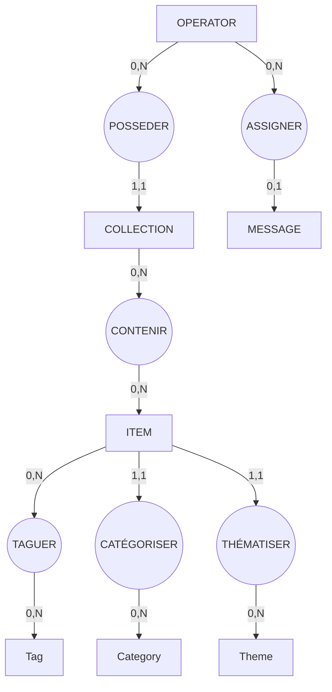

# **Session 7 : Du MCD au MLD puis du MLD au MPD**

### *Version corrigée : Sans tables associatives au MCD et en snake_case uniquement*

---

# 1. Introduction

Un bon modèle de données se construit en trois étapes :

1. **MCD (Modèle Conceptuel des Données)**
   → On ne parle que d’idées, d’entités et de relations. Pas de tables. Pas de clés.

2. **MLD (Modèle Logique des Données)**
   → On transforme les relations en tables, on ajoute les clés étrangères, on crée les tables d’association.

3. **MPD (Modèle Physique des Données)**
   → On prépare la version finale adaptée au SGBD (MySQL/MariaDB).

Chaque étape traduit la précédente, sans en sauter une.

---

# 2. Étape 1 : Construire le MCD (Conceptuel)

Le **MCD** décrit le *sens* du système, sans logique SQL.

## 2.1 Les entités du projet

Les objets principaux manipulés par le système sont :

* **item** (contenu)
* **theme**
* **category**
* **tag**
* **operator** (utilisateur/admin)
* **message** (formulaire contact)
* **collection** (favoris, wishlist, panier)

>  **Important : aucune table d’association n’apparaît ici.**
Elles n’existent pas encore.

---

## 2.2 Les relations (exprimées conceptuellement)

### Relations obligatoires

* Un **item** appartient à **un theme** (1,1).
* Un **item** appartient à **une category** (1,1).
* Un **item** est créé par **un operator** (1,1).

### Relations facultatives

* Un **operator** peut gérer plusieurs **collections** (1,N).
* Un **operator** peut traiter plusieurs **messages** (1,N ou 0,N).

### Relations multiples (N,N) : *conceptuelles* :

* Un **item** peut avoir plusieurs **tags**,
  et un **tag** peut être associé à plusieurs **items** → relation **N,N**.

* Une **collection** peut contenir plusieurs **items**,
  et un **item** peut figurer dans plusieurs **collections** → relation **N,N**.

>  **Dans le MCD, on ne crée pas les tables d’association.
On se contente de dire que la relation est N,N.**

---

# 3. Étape 2 : MCD → MLD

Le **MLD** est la traduction logique du MCD.

## 3.1 Règles essentielles

1. **Entité → Table**
2. **Relation 1,N → clé étrangère du côté N**
3. **Relation N,N → table d’association** *(c’est ici qu’apparaissent item_tag et collection_item)*
4. **Les noms sont en snake_case**

---

## 3.2 Application au projet

### 3.2.1 Tables issues des entités du MCD

* `item`
* `theme`
* `category`
* `tag`
* `operator`
* `message`
* `collection`

### 3.2.2 Clés étrangères issues des relations 1,N

| Relation MCD               | Transformation MLD                   |
| -------------------------- | ------------------------------------ |
| item → theme               | `item.theme_id`                      |
| item → category            | `item.category_id`                   |
| item → operator (créateur) | `item.created_by`                    |
| message → operator         | `message.operator_id` *(facultatif)* |
| collection → operator      | `collection.operator_id`             |

### 3.2.3 Relations N,N → tables d’association

>  Elles apparaissent **uniquement au MLD**, jamais au MCD.

| Relation MCD      | Table d’association (MLD) |
| ----------------- | ------------------------- |
| item ↔ tag        | `item_tag`                |
| collection ↔ item | `collection_item`         |

Chaque table d’association contient **deux clés étrangères** et interdit les doublons.

---

# 4. Étape 3 : MLD → MPD

Le **MPD** est la version exploitable par MySQL/MariaDB.
On y ajoute :

* les types (INT, VARCHAR, TEXT)
* les contraintes (NOT NULL, UNIQUE…)
* les clés primaires / étrangères
* éventuellement les index

Voici une **version textuelle, simple et pédagogique**, sans SQL précis.

---

## 4.1 Tables principales

### 🔹 `operator`

* e-mail unique
* mot de passe haché
* statut actif / inactif

---

### 🔹 `theme`

* nom unique

### 🔹 `category`

* nom unique

### 🔹 `tag`

* nom unique

---

### 🔹 `item`

* titre unique
* slug unique
* statut obligatoire
* appartient à un theme (`theme_id`)
* appartient à une category (`category_id`)
* créé par un operator (`created_by`)
* possède une description courte et un contenu long

---

### 🔹 `item_tag` (table d’association)

* `item_id` + `tag_id`
* la combinaison doit être unique

---

### 🔹 `collection`

* appartient à un operator (`operator_id`)
* possède un type (wishlist, favoris, panier…)

---

### 🔹 `collection_item`

* `collection_id` + `item_id`
* la combinaison doit être unique

---

### 🔹 `message`

* nom + email + contenu
* date d’envoi
* statut lu / non lu
* éventuellement `operator_id` pour assignation

---

# 5. Synthèse pédagogique

| Niveau  | Ce qu’on y met                                            | Ce qu’on ne met pas                              |
| ------- | --------------------------------------------------------- | ------------------------------------------------ |
| **MCD** | les entités, les relations                                | ❌ clés étrangères ❌ types ❌ tables d’association |
| **MLD** | les tables, les clés étrangères, les tables d’association | ❌ SQL spécifique                                 |
| **MPD** | la version finale adaptée au SGBD                         | -                                                |

---

# 6. Conclusion pour les étudiants

* Le MCD est une **carte du monde**, sans détails techniques.
* Le MLD est la **traduction logique**, où apparaissent pour la première fois `item_tag` et `collection_item`.
* Le MPD est la **réalisation concrète**, prête à être écrite en SQL.

Comprendre ces étapes, c’est la base d’un bon développeur backend.