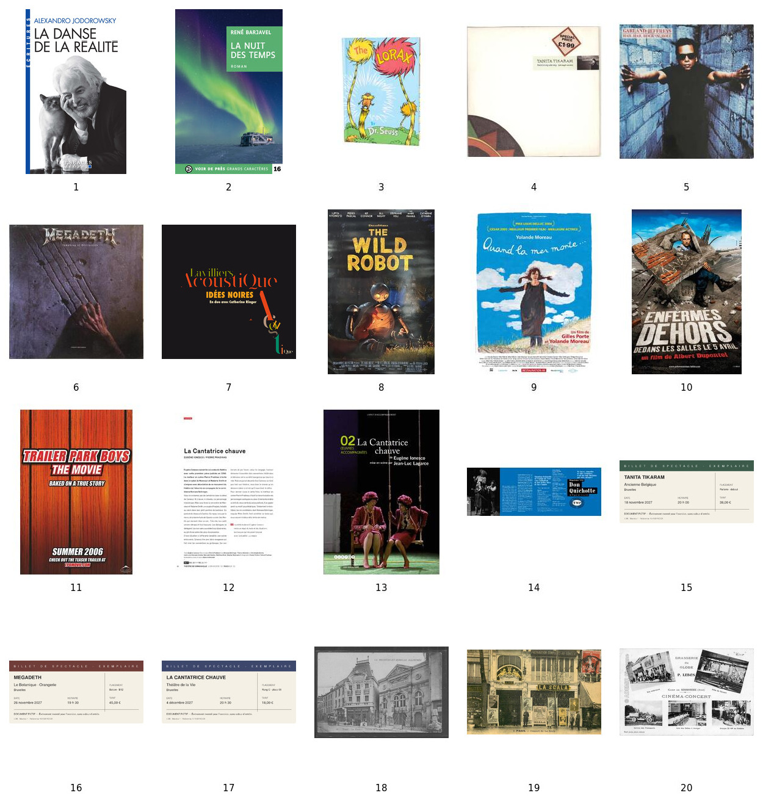

# Corpus visuel — Séance 1

Le corpus retient **42 documents, tous disponibles**, dont les douze couvertures de livres et bandes dessinées. **Le Dit du Genji** (nº 22) et **Cent Ans de solitude** (nº 25) sont inclus dans le corpus visuel comme dans le code source. La sélection comprend des œuvres d’origines et de langues variées. Les trois billets sont explicitement marqués comme fictifs ; leurs dates, horaires, tarifs et placements sont inventés.

Les chemins des 42 documents retenus sont réunis dans [corpus.json](corpus.json), tous avec le statut `available`. Les vingt images remplacées ont été supprimées. Les informations de provenance renseignées — URL sources, dimensions, empreintes SHA-256 et conversions — figurent dans [sources.json](sources.json). Les PDF originaux et les images alternatives restent dans `sources/`.

Chaque document de [exo/session_01.html](../../exo/session_01.html) est une balise `<figure>` contenant son image. Les informations du document figurent dans le texte alternatif de l’image, son attribut `alt`, et son chemin dans l’attribut `src`. Les attributs `data-id`, `data-x` et `data-y` sont utilisés par le JavaScript pour l’identification et le placement. Le texte alternatif et le chemin sont lisibles avec **Ctrl+U**, puis recherchables avec **Ctrl+F**. Les correspondances dans les chemins sont conservées pour montrer qu’un nombre d’occurrences peut différer du nombre de documents ; une formulation plus précise, comme `Couverture de livre`, permet d’affiner le comptage. Lors d’un remplacement de référence, mettre à jour le bloc HTML et le manifeste. Le déroulé de la démonstration et les comptages figurent dans la [préparation de séance](../../preparation/session_01.md#démonstration--rechercher-dans-le-code-source).

Pour les trois comptages, conserver au début des textes alternatifs concernés l’une des expressions exactes `Couverture de livre`, `Pochette de disque` ou `Affiche de cinéma`, une seule fois par document. Les précisions sur le support et la description visuelle viennent ensuite. Le manga nº 27 fait partie des livres ; le livret DVD nº 13 reste un document de théâtre. Lors d’une modification du corpus, mettre aussi à jour les consignes, les totaux et les listes de numéros de la préparation.

## Documents disponibles — 1 à 20

| Nº | Image | Source / origine |
|---|---|---|
| 1 | [La Danse de la réalité](01-jodorowsky.png) | [Source](https://www.albin-michel.fr/la-danse-de-la-realite-9782226326959) |
| 2 | [La Nuit des temps](02-barjavel.jpg) | [Source](https://www.voir-de-pres.fr/livres/la-nuit-des-temps/) |
| 3 | [The Lorax](03-seuss.jpg) | [Source](https://understory-shop.com/collections/library) |
| 4 | [Twist in My Sobriety](04-tanita-tikaram.jpg) | [Source](https://eil.com/shop/moreinfo.asp?catalogid=64246) |
| 5 | [Hail Hail Rock ’n’ Roll](05-garland-jeffreys.jpg) | [Source](https://diggovinyl.com/products/garland-jeffreys-hail-hail-rock-n-roll-1) |
| 6 | [Symphony of Destruction](06-megadeth.jpg) | [Source](https://vinylpladen.de/vinyl/megadeth/symphony-of-destruction-LP) |
| 7 | [Idées noires — Catherine Ringer](07-lavilliers-ringer.jpg) | [Source](https://open.spotify.com/track/5cA09u4ZTpOVRDXYfOJ0sE) |
| 8 | [The Wild Robot — affiche cinéma avec générique](08-the-wild-robot-cinema.jpg) | [Source](https://www.ebay.com/itm/116302708745) |
| 9 | [Quand la mer monte…](09-quand-la-mer-monte.jpg) | [Source](https://www.allocine.fr/film/fichefilm_gen_cfilm=57392.html) |
| 10 | [Enfermés dehors](10-enfermes-dehors.jpg) | [Source](https://www.albertdupontel.com/filmographie/enfermes-dehors/) |
| 11 | [Trailer Park Boys: The Movie](11-trailer-park-boys.jpg) | [Source](https://www.impawards.com/intl/canada/2006/trailer_park_boys.html) |
| 12 | [La Cantatrice chauve — programme de Cornouaille, Pierre Pradinas](12-cantatrice-pradinas.jpg) | [Source](https://cdn.theatre-cornouaille.fr/wp-content/uploads/2022/09/21145547/1718-theatre-cornouaille-brochure-web.pdf) |
| 13 | [La Cantatrice chauve — livret du DVD, Jean-Luc Lagarce](13-cantatrice-lagarce.jpg) | [Source](https://www.reseau-canope.fr/notice/la-cantatrice-chauve-de-eugene-ionesco-mise-en-scene-par-jean-luc-lagarce_695.html) |
| 14 | [Don Quichotte — programme du TNP](14-don-quichotte.jpg) | [Source](https://www.tnp-villeurbanne.com/spectacle/don-quichotte-2013/) |
| 15 | [TANITA TIKARAM](15-billet-tanita.svg) | Billet fictif créé localement |
| 16 | [MEGADETH](16-billet-megadeth.svg) | Billet fictif créé localement |
| 17 | [LA CANTATRICE CHAUVE](17-billet-cantatrice.svg) | Billet fictif créé localement |
| 18 | [Toul — Le Théâtre — carte postale ancienne (lieu provisoire)](18-carte-theatre.jpg) | [Source](https://www.delcampe.net/fr/collections/cartes-postales/france/toul/54-toul-le-theatre-entree-de-la-rue-gambetta-99326192.html) |
| 19 | [Paris — Concert de La Scala — carte postale ancienne (lieu provisoire)](19-carte-concert.jpg) | [Source](https://sallesdecinemas.blogspot.com/2009/06/scala-paris-10eme.html) |
| 20 | [Sissonne — Cinéma-Concert — carte postale ancienne (lieu provisoire)](20-carte-cinema.jpg) | [Source](https://ville-sissonne.fr/histoire_cinemas.php) |

## Sélection diversifiée — 21 à 42

Tous les fichiers de cette section sont disponibles. Les [URL directes et leur état](../../preparation/visuels-session_01-a-telecharger.json) sont conservés avec le [script de téléchargement](../../preparation/telecharger-visuels-session_01.sh).

Les pays et aires culturelles servent à préparer la sélection ; ils ne sont pas affichés sur le plateau. Pour les livres, une traduction française reste possible. Conserver les inscriptions originales des pochettes et des affiches lorsqu’elles sont lisibles et exploitables pour l’activité.

| Nº | Référence | Origine ou contexte culturel | Support | Fichier |
|---|---|---|---|---|
| 21 | Priya PADMA — Sens unique — Lauise Warinda | Référence demandée | Couverture de livre | `21-priya-padma-sens-unique.jpg` |
| 22 | Le Dit du Genji — Murasaki Shikibu | Japon | Couverture de livre | `22-dit-du-genji-murasaki-shikibu.jpg` |
| 23 | Le Palais des rêves — Ismail Kadaré | Albanie | Couverture de livre | `23-palais-des-reves-kadare.jpg` |
| 24 | Don Quichotte — Miguel de Cervantès | Espagne | Couverture de livre | `24-don-quichotte-cervantes.jpg` |
| 25 | Cent Ans de solitude — Gabriel García Márquez | Colombie | Couverture de livre | `25-cent-ans-de-solitude-garcia-marquez.jpg` |
| 26 | La Végétarienne — Han Kang | Corée du Sud | Couverture de livre | `26-la-vegetarienne-han-kang.jpg` |
| 27 | Akira, tome 1 — Katsuhiro Ōtomo | Japon | Couverture de bande dessinée | `27-akira-tome-1-otomo.jpg` |
| 28 | Buena Vista Social Club — album collectif | Cuba | Pochette de disque | `28-buena-vista-social-club.jpg` |
| 29 | Clube da Esquina — Milton Nascimento et Lô Borges | Brésil | Pochette de disque | `29-clube-da-esquina.jpg` |
| 30 | Mulatu of Ethiopia — Mulatu Astatke | Éthiopie | Pochette de disque | `30-mulatu-of-ethiopia.jpg` |
| 31 | Miss Perfumado — Cesária Évora | Cap-Vert | Pochette de disque | `31-miss-perfumado-cesaria-evora.jpg` |
| 32 | Las últimas composiciones — Violeta Parra | Chili | Pochette de disque | `32-ultimas-composiciones-violeta-parra.jpg` |
| 33 | Le Voyage de Chihiro — Hayao Miyazaki | Japon | Affiche de cinéma | `33-voyage-de-chihiro-affiche.jpg` |
| 34 | Une séparation — Asghar Farhadi | Iran | Affiche de cinéma | `34-une-separation-affiche.jpg` |
| 35 | Parasite — Bong Joon-ho | Corée du Sud | Affiche de cinéma | `35-parasite-affiche.jpg` |
| 36 | Pather Panchali — Satyajit Ray | Inde | Affiche de cinéma | `36-pather-panchali-affiche.jpg` |
| 37 | Alf Leila wa Leila — Oum Kalthoum | Égypte | Pochette de disque | `37-alf-leila-wa-leila-oum-kalthoum.jpg` |
| 38 | Les Mille et Une Nuits — recueil anonyme | Traditions arabes, persanes et indiennes | Couverture de livre | `38-mille-et-une-nuits.jpg` |
| 39 | Neige — Orhan Pamuk | Turquie | Couverture de livre | `39-neige-orhan-pamuk.jpg` |
| 40 | Teatro Colón — façade, Buenos Aires | Argentine | Photographie de lieu | `40-teatro-colon-buenos-aires.jpg` |
| 41 | Teatro La Fenice — façade, Venise | Italie | Photographie de lieu | `41-la-fenice-venise.jpg` |
| 42 | Opéra de Harbin — bâtiment, Harbin | Chine | Photographie de lieu | `42-opera-harbin.jpg` |

**Priya PADMA — Sens unique** reste la référence de **Lauise Warinda**, ISBN **9798332039683** ([notice bibliographique](https://www.chasse-aux-livres.fr/prix/B0DBF7PWYK/priya-padma-sens-unique-9798332039683)).

Repères documentaires : [Le Palais des rêves — éditeur](https://www.hachette.fr/livre/le-palais-des-reves-9782253064749/), [Clube da Esquina — album](https://music.apple.com/us/album/clube-da-esquina/1473446573), [Mulatu of Ethiopia — disque](https://www.eatethio.com/records/mulatu-of-ethiopia), [Violeta Parra — ministère chilien de la Culture](https://www.cultura.gob.cl/wp-content/uploads/2017/05/cuaderno-violeta-parra.pdf), [Alf Leila wa Leila — disque](https://ummkulthum.bandcamp.com/album/alf-leila-wa-leila). Les sources des vingt nouveaux fichiers présents sont renseignées dans `sources.json`.

### Possibilités de classement

Les supports restent variés : livres et bande dessinée, disques, affiches, documents de théâtre, billets, cartes postales et photographies. *La Cantatrice chauve* et *Don Quichotte* conservent plusieurs représentations ; Tanita Tikaram et Megadeth apparaissent sur une pochette et un billet. Les autres références élargissent les possibilités de rapprochement sans imposer un classement géographique ni supposer que les étudiants connaissent les œuvres.

Les réponses doivent se justifier par les documents visibles. Pour les photographies, préférer une vue portant le nom du lieu ; ne pas demander de reconnaître un bâtiment à partir de connaissances extérieures.

## Choix et variantes

- Les deux versions de *La Cantatrice chauve* sont celles de **Pierre Pradinas** et **Jean-Luc Lagarce**. La première provient de la page 30 du PDF du programme de Cornouaille ; la seconde est la couverture du livret accompagnant un DVD. Ce dernier remplace provisoirement un programme de salle.
- *Don Quichotte* est représenté par la première page dépliée du programme du TNP. Les pages sont converties intégralement, sans ajout de données.
- Pour *The Wild Robot*, l’affiche cinéma avec le générique est retenue : **Chris Sanders** y est lisible. Son crédit de réalisation est confirmé par la [fiche officielle DreamWorks](https://www.dreamworks.com/movies/the-wild-robot) et figure dans le texte alternatif du document 08. La version sans générique reste dans `sources/`.
- La pochette d’*Idées noires* mentionne bien **Catherine Ringer**.
- La sélection provisoire des cartes postales est **Toul — Le Théâtre**, **Paris — Concert de La Scala** et **Sissonne — Cinéma-Concert**. Elle représente des lieux historiques ; le caractère indépendant des trois lieux n’est pas établi. Les lieux personnels restent à choisir.
- Les deux **documents de théâtre** de *La Cantatrice chauve*, dont un livret de DVD, sont distincts de son billet.

## Vérification des questions

Après avoir classé librement les documents, chaque groupe répond aux [treize questions de la séance](../../session_01.md#5-rechercher-dans-le-classement) : dix recherches de mentions précises et trois comptages par support — livres, pochettes de disques et affiches de cinéma. Chaque réponse s’appuie sur les documents retrouvés ; chaque total doit être accompagné de la liste des documents retenus pour permettre de retrouver un oubli ou un double comptage. Les petites inscriptions peuvent nécessiter l’agrandissement.

Les conventions de comptage figurent dans la [préparation de séance](../../preparation/session_01.md).

## Provenance

Le téléchargement ne constitue pas une licence libre. Les références des documents et leurs sources sont conservées ; aucune autorisation de republication n’est affirmée pour les œuvres téléchargées.

GitHub Pages héberge le site du cours depuis la branche `main`, à la racine du dépôt. Le plateau `exo/session_01.html` utilise `asset/session_01.css`, `asset/session_01.js` et les 42 images référencées dans le [manifeste](corpus.json). Les consignes d’[accès au plateau](../../preparation/session_01.md#accès-par-github-pages) figurent dans la préparation de séance.
