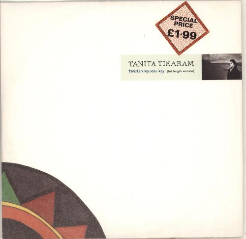

# Séance 1 — Définir, classer et retrouver

La séance explore deux échelles : avant la pause, on part de ce que l’on connaît pour aller jusqu’au **bit**, la plus petite unité de donnée numérique ; après la pause, on passe à l’organisation d’un ensemble de documents par la **classification**.

## Introduction — Le formateur et les cours

Le formateur se présente et présente les trois cours que nous suivrons avec lui : **LDB, LPB et ADB**. Il explique leurs objectifs, leur articulation et l’organisation du travail.

On précise les contraintes d’organisation et de travail, puis on prend le temps de poser les questions sur les cours et leur déroulement. On note les réponses utiles et les points qui restent à clarifier.

## 1. Mettre les mots en commun

On part de cette question : **quand on vous dit "base de donnees" a quoi pensez vous ?**

On inscrit au tableau tous les mots proposés par les étudiants et on demande un exemple concret pour chacun. Les propositions restent visibles pendant la discussion, même lorsque plusieurs significations apparaissent pour un même mot.

On élargit ensuite la recherche :

- Quelles données existent sur papier ?
- Que peut-on conserver à propos d’un contenu, d’une personne ou d’un message ?
- Quelles données proviennent d’une saisie ? D’une action sur le site ? D’un calcul ?
- Que signifient les mots « donnée », « information », « fichier » et « base de données » ?

On regroupe les propositions qui semblent proches. Pour chaque désaccord, on conserve les différentes explications et l’exemple qui permet de les discuter.

Le résultat de cette mise en commun est une liste de mots accompagnés d’exemples et de définitions provisoires. On la conserve pour la reprendre en fin de séance.

## 2. Construire une histoire et aller vers le binaire

Le formateur invente une histoire en utilisant tous les mots inscrits au tableau. On suit les liens entre les mots et on précise leur sens dans le contexte du récit. Les mots restent visibles pour vérifier qu’ils ont tous été utilisés.

L’histoire conduit à une question : comment représenter dans un ordinateur les données que nous venons d’évoquer ? On aboutit à une représentation utilisant deux symboles, `0` et `1` : le binaire. La section suivante introduit le bit, l’octet et l’encodage du texte.

Au fil du récit, on distingue les données, le contexte qui leur donne du sens et les conclusions que l’on peut en tirer. Les exemples suivants peuvent servir à préciser ces distinctions.

### Une valeur sans contexte

On observe cette valeur :

```text
12
```

On propose plusieurs significations possibles. Qu’est-ce qui manque pour choisir entre ces interprétations ?

On ajoute ensuite le contexte :

```text
Nombre d’éléments publiés : 12
```

On formule ce que cette indication permet de savoir. Peut-on également en déduire le nombre de brouillons ou la date de publication des éléments ?

<details>
<summary>Après la discussion : donnée, information et interprétation</summary>

Une **donnée** est une valeur ou une description représentée sous une forme qui permet de la conserver, de la transmettre ou de la traiter. `12`, un titre, une photographie et une date peuvent constituer des données.

Une **information** est ce que l’on peut apprendre à partir de données replacées dans un contexte. Ici, le libellé permet de comprendre à quoi correspond le nombre `12`.

L’**interprétation** consiste à attribuer un sens aux données à partir du contexte et de règles. Elle peut être incorrecte si le contexte manque ou si une règle est supposée à tort.

La valeur `12` ne suffit pas à connaître le nombre de brouillons. Le libellé ajouté ne donne pas non plus la période concernée ni le moment du comptage.

</details>

### Ce qui est écrit et ce que l’on suppose

On observe deux indications :

```text
Statut : brouillon
```

```text
Publication prévue : 10 novembre
```

On distingue ce qui est explicitement indiqué de ce qui reste à vérifier. Une publication prévue suffit-elle à affirmer que l’élément est déjà publié ?

On reprend un exemple du brainstorming. On précise la donnée conservée, son contexte et une conclusion qu’elle permet réellement de soutenir.

## 3. Représenter le texte dans un ordinateur

### Une même suite, plusieurs lectures

On observe cette suite sans lui attribuer immédiatement une signification :

```text
01000001
```

On décrit d’abord ce qui est visible : les symboles utilisés, leur nombre et leur ordre. On cherche ensuite la règle qui manquerait pour lire cette suite comme un nombre ou comme du texte.

Un **bit** peut prendre deux valeurs, notées `0` et `1`. Un groupe de huit bits forme un **octet**. Les données numériques sont représentées par des suites de bits ; leur lecture dépend des règles utilisées.

On reçoit deux règles de lecture pour les mêmes huit bits :

- Lus comme un entier non signé écrit en binaire, ils représentent le nombre `65`.
- Lus comme un octet de texte selon l’encodage UTF-8, ils représentent la lettre `A`.

Les bits ont-ils changé ? Qu’est-ce qui explique la différence entre les deux résultats ?

Un **encodage du texte** définit comment représenter les caractères par des octets. UTF-8 est un encodage. Il utilise un ou plusieurs octets selon le caractère : la taille d’un texte en octets n’est donc pas toujours égale au nombre de caractères affichés.

### Retrouver un petit texte

Pour cette activité, on fournit les correspondances suivantes en UTF-8 :

```text
A       01000001
B       01000010
C       01000011
espace  00100000
```

On utilise ces correspondances pour lire :

```text
01000011 01000001 01000010
```

On représente ensuite le texte `BAC`, puis `A B`. On compare le nombre de caractères, espaces compris, et le nombre d’octets dans ces deux exemples.

La vérification se fait dans les deux sens : on relit les octets obtenus avec les correspondances fournies. Le texte retrouvé doit être exactement celui du départ, y compris les espaces.

## 4. Réorganiser librement

Après la pause, on change d’échelle. On vient d’étudier les unités qui représentent les données dans un ordinateur ; on s’intéresse maintenant à la manière d’organiser de nombreux documents pour y retrouver des informations.

On ouvre l’[interface web de classement](https://efp-dev.github.io/1-X75-LDB/session_01.html) sur GitHub Pages pour l’activité. Le corpus comprend 42 documents culturels : couvertures, pochettes, affiches, documents de théâtre, billets, cartes postales et photographies de lieux. Ces objets peuvent être publiés et réunis en collections dans le [projet du module](projet.md). Un clic agrandit une image pour lire les données qui y sont inscrites.

L’activité se déroule sur un ordinateur connecté à Internet, dans un espace tenant à l’écran. Les positions ne sont pas sauvegardées : recharger la page rétablit la disposition initiale.

Chaque groupe part du même ensemble de documents, dans la même disposition initiale. **On commence directement par les réorganiser librement.**

On crée un fichier `observations-classement.md` pour conserver la règle de classement, les difficultés rencontrées et les réponses aux recherches qui suivront. Ce fichier sert aux notes de l’activité ; il ne contient pas le jeu de données.

On déplace les images par glisser-déposer dans un espace libre, sans zone prédéfinie. Les regroupements apparaissent par leur position. On décrit et nomme librement ces regroupements dans les notes.

**Le texte des documents reste inchangé. Aucun document n’est supprimé ni dupliqué.** Les classements des groupes portent sur le même ensemble de données.

On note la règle envisagée, puis on l’applique. Lorsqu’un document pourrait appartenir à plusieurs groupes, on décrit le problème et le choix effectué. Cette difficulté fait partie des observations à conserver.

À la fin du rangement, on vérifie que les 42 documents sont encore présents et on décrit le classement dans `observations-classement.md`. On conserve une capture de l’ensemble : elle servira à la comparaison des classements et à la séance suivante.

## 5. Rechercher dans le classement

On utilise le classement obtenu, sans recharger la page ni déplacer les documents pendant les recherches.

Le formateur pose les treize questions suivantes dans l’ordre. Elles comprennent dix recherches d’informations et trois comptages. Chaque groupe y répond à partir de son classement.

1. Quel document affiche un prix de 1,99 livre sterling ?
2. Quel document porte la référence CML-2456 ?
3. Combien de livres sont représentés, bandes dessinées comprises ?
4. Sur quelle façade peut-on lire « Societas MDCCXCII » ?
5. Quel document porte le logo d’Ethiopian Airlines ?
6. Quelle carte postale mentionne un moteur de 25 HP ?
7. Combien de pochettes de disques y a-t-il ?
8. Quel spectacle annonce une durée de 1 h 25 ?
9. Quel billet indique le placement « Balcon · B12 » ?
10. Quelle carte postale montre un Hôtel-Café de la Comédie ?
11. Combien d’affiches de cinéma y a-t-il ?
12. Quel document mentionne Ravi Shankar comme compositeur ?
13. Quelle pochette mentionne l’année 1972 ?

Pour chaque question, on note :

- la réponse, avec les titres ou les références permettant de retrouver les documents ;
- les documents qui justifient cette réponse ;
- le chemin suivi et les éventuels retours en arrière ;
- le temps nécessaire pour retrouver les documents et établir la réponse ;
- les hésitations ou les informations qui manquent.

Pour chaque comptage, on relève les documents retenus afin de pouvoir vérifier le total et repérer les oublis ou les doubles comptages.

Une réponse incertaine reste signalée comme telle. L’absence de résultat après une recherche ne suffit pas à affirmer qu’aucun document ne correspond.

## 6. Comparer les classements

On relève une recherche simple à effectuer dans son classement, une recherche difficile et la raison observable de chaque résultat : regroupement directement repéré, documents répartis entre plusieurs groupes ou critère ambigu.

### Faire utiliser le classement par un autre groupe

Un autre groupe reprend les **questions 1 et 3**, communes à la classe : retrouver le document affichant un prix de 1,99 livre sterling et compter les livres, bandes dessinées comprises. Il utilise notre classement sans recevoir d’explication orale sur le rangement. On utilise le même ordinateur, sans recharger la page ni déplacer les documents. On observe les regroupements vers lesquels il se dirige et les critères qu’il comprend ou interprète autrement.

Le groupe doit retrouver les documents qui justifient ses réponses et désigner ceux qu’il compte, même s’il connaît déjà les résultats. On note les parcours et les hésitations, puis on échange sur les critères compris. Si les réponses diffèrent, on retourne aux documents pour repérer un oubli, un double comptage ou une interprétation différente.

### Mettre les observations en commun

On compare ensuite les classements obtenus dans la classe :

- Quel critère organise chaque classement ?
- Quels documents se retrouvent ensemble ?
- Quelles recherches ce choix facilite-t-il ?
- Quel document a été difficile à placer, et pourquoi ?
- Une autre personne peut-elle retrouver l’information à partir des noms choisis ?

On justifie les comparaisons par les recherches réellement effectuées. Un classement par support peut faciliter la recherche d’un livre tout en séparant une œuvre de son programme de théâtre et de son billet. Le temps dépend aussi de la familiarité avec les documents ; on explique les différences à partir des parcours observés.

## 7. Chercher autrement dans les mêmes documents

Après la comparaison des classements, le formateur montre une autre manière de répondre aux mêmes questions. On observe ce qui permet de trouver l’information plus vite et ce qui reste à vérifier.

<details>
<summary>Après la démonstration : le code source et la recherche du navigateur</summary>

### Retrouver les descriptions des images

Depuis le plateau de classement, **Ctrl+U** ouvre le code source HTML de la page. Dans cet onglet, **Ctrl+F** ouvre la recherche de texte du navigateur.

Les images possèdent déjà des descriptions textuelles dans leur attribut `alt`. Ces textes alternatifs décrivent leur contenu, notamment pour les personnes qui utilisent un lecteur d’écran. Ils permettent aussi de retrouver les informations sans lire les inscriptions dans les images.

Pour reprendre la question 1, on cherche `1.99`. La description du document 04 permet de retrouver la pochette de Tanita Tikaram :

```html

```

L’attribut `src` indique le chemin du fichier image. L’attribut `alt` décrit ici le support, le titre, l’interprète et le prix inscrit. Le navigateur cherche dans ce texte ; les inscriptions de l’image ont déjà été transcrites. La notation compte : le texte utilise un point dans `1.99`, alors que la question utilise une virgule.

On lit la description du document trouvé, puis on retourne à l’image pour vérifier la réponse. Pour reprendre une autre recherche, on choisit une mention précise de la question : référence, inscription, durée ou nom.

### Distinguer les occurrences et les documents

Avec une recherche sans distinction entre majuscules et minuscules, `Megadeth` donne quatre résultats dans le code source pour deux documents : la pochette 06 et le billet 16. Le nom apparaît dans le chemin du fichier et dans le texte alternatif de chacun. Pour la question 9, la mention `B12` permet de retrouver le billet concerné.

Le nombre affiché par la recherche est donc un **nombre d’occurrences du texte recherché**. Pour l’interpréter comme un nombre de documents, il faut vérifier ce qui a été compté.

Dans l’onglet du code source de `session_01.html`, on reprend les trois comptages en cherchant successivement `Couverture de livre`, `Pochette de disque` et `Affiche de cinéma`. Chaque description concernée commence par l’une de ces expressions, présente une seule fois par document. On compare les résultats aux comptages visuels et on retrouve les documents qui les justifient.

On essaie aussi `livre` seul : ce texte apparaît dans `livret d’accompagnement du DVD`, au document 13. De même, `affiche` apparaît dans certains chemins d’images. On explique pourquoi une formulation plus précise change le résultat et répond mieux à la question posée.

### Comprendre le besoin avant de construire l’outil

**Pour répondre aux questions de cette activité, les données de la page et la recherche du navigateur suffisent.** Les descriptions sont déjà conservées dans un fichier et un outil permet déjà de les retrouver. Cette autre manière d’exploiter les documents reste disponible quel que soit leur classement visuel.

Le cours nous apprendra à construire et à gérer des bases de données, ainsi qu’à écrire des recherches. Le choix d’un nouvel outil devra répondre à des opérations précises : retrouver, compter, rapprocher ou modifier les données. On commence donc par identifier les besoins et par comprendre ce que les données et les outils disponibles permettent déjà de faire.

Dans `observations-classement.md`, on conserve une recherche effectuée dans le code source, sa réponse vérifiée et un exemple où le nombre d’occurrences diffère du nombre de documents.

</details>

## 8. Nommer ce qui a été observé

### Organiser et classer

**Classer** consiste à regrouper ou à ordonner des éléments selon des critères. Dans l’activité, l’œuvre, l’artiste ou la nature du document peuvent servir de critères.

On reprend un regroupement réalisé et on formule sa règle en une phrase. On vérifie cette règle sur un document placé à l’intérieur et sur un document placé ailleurs.

Un nom comme « divers » indique peu de choses sur la place d’un nouveau document. Une règle explicite aide à décider où ranger et où chercher. Plusieurs classements restent possibles selon les usages.

### Base de données et SGBD

Une **base de données** est un ensemble organisé de données conservées pour être retrouvées et exploitées. L’organisation doit permettre de répondre aux besoins de l’application.

Un **système de gestion de base de données**, ou **SGBD**, est un logiciel qui permet de définir, de conserver, de rechercher et de modifier des données. Il fournit aussi des mécanismes de contrôle des accès et de cohérence.

Dans la démonstration, le fichier HTML joue le rôle d’une petite base de données en fichier plat. La recherche du navigateur est l’outil utilisé pour l’interroger. Ces deux éléments suffisent aux recherches réalisées ; un SGBD répondra à d’autres besoins de gestion au fil du cours.

Dans le projet, les éléments publiés, les utilisateurs et les collections font partie des données. Le SGBD est le logiciel qui les gère. L’application utilise ces données pour proposer ses pages et ses fonctions.

L’apparence de l’interface ne permet pas, à elle seule, de savoir comment les données sont conservées. Déplacer une carte à l’écran n’implique pas nécessairement de déplacer un fichier dans un dossier.

On reprend la liste de mots du début. On corrige les définitions provisoires à partir des exemples rencontrés, puis on explique la différence entre les données de l’application et le logiciel qui les gère.

## 9. Du classement aux langages de bases de données

### Trouver du texte et répondre à la question

Ctrl+F recherche une suite de caractères. Pour chercher les documents qui affichent un prix à payer, on essaie `prix` dans le code source, puis on examine le contexte des occurrences.

| Cas dans le corpus | Ce que la recherche permet de constater |
|---|---|
| L’affiche de *Quand la mer monte...*, document 09, mentionne le **prix Louis-Delluc 2004**. | `prix` est présent, mais il désigne une récompense. C’est un **faux positif** pour la recherche d’un montant à payer. |
| La pochette de Tanita Tikaram, document 04, porte **Special Price £1.99**. | Son texte alternatif contient un montant, mais pas le mot français `prix`. Cette recherche manque donc un document pertinent : un **faux négatif**. |

On retrouve le document 04 avec `1.99`. La notation compte : le texte enregistré utilise un point, alors que la question en français peut employer la virgule dans « 1,99 livre sterling ».

Si une information de l’image a été omise dans la description, aucune recherche dans ce texte ne peut la retrouver. La fiabilité dépend à la fois de la formulation de la recherche et de la manière dont le document a été décrit.

### Une base conserve un état du système

Le montant `£1.99` permet d’affirmer qu’un prix figure sur cette pochette. Il ne suffit pas à connaître le prix de vente du disque aujourd’hui. De même, un numéro conservé dans les contacts peut avoir été correct lors de sa saisie et avoir changé depuis.

**Une base de données contient un état enregistré du système, selon un modèle et à un moment donné.** Cet état peut réunir des observations, des déclarations, des calculs ou des prévisions. Leur enregistrement ne garantit ni leur exactitude initiale ni leur validité actuelle.

Deux vérifications sont donc nécessaires :

- **La recherche traduit-elle correctement la question ?** Les critères doivent sélectionner les données qui répondent au besoin.
- **Les données représentent-elles correctement la situation concernée ?** Leur sens, leur provenance, leur date et les éventuelles omissions doivent être compris.

Un SGBD peut faire respecter des règles de cohérence, par exemple exiger un montant positif. Un montant erroné peut toutefois respecter cette règle. La cohérence interne et la fidélité au réel sont deux exigences distinctes.

### Vers les requêtes et SQL

Une **requête** est une demande adressée à un système pour obtenir des données selon des critères. **SQL** permet notamment d’exprimer ces demandes dans une base relationnelle. On apprendra à formuler ces critères, puis à vérifier les résultats et ce qu’ils permettent d’affirmer.

### Justifier une réponse

On reprend une réponse obtenue dans le corpus. Dans `observations-classement.md`, on précise le critère de recherche, la raison de retenir ou d’écarter un résultat et ce que le document permet réellement d’affirmer. Une information absente reste signalée comme inconnue.

## 10. Conserver les résultats

Dans `observations-classement.md`, on conserve :

- les réponses justifiées aux treize questions et les trois inventaires ;
- la règle de classement et les difficultés rencontrées ;
- les observations lors de l’utilisation par un autre groupe et une comparaison appuyée sur une recherche précise ;
- une recherche dans le code source et la manière dont sa réponse a été vérifiée ;
- un exemple de différence entre le nombre d’occurrences et le nombre de documents ;
- une explication de la différence entre donnée et information ;
- une explication du rôle de l’encodage dans la lecture des bits ;
- une distinction entre base de données, SGBD et application ;
- la justification rédigée pendant la synthèse : critère de recherche, raison de retenir ou d’écarter un résultat et limites de ce que le document permet d’affirmer.

On termine par une question que le classement obtenu laisse difficile à résoudre. On indique si la recherche dans le code source permet d’y répondre et ce qui reste difficile.

Pour la séance 2, on conserve `observations-classement.md`, les captures et l’accès aux 42 documents avec leurs descriptions complètes, notamment les mentions utilisées dans les treize questions. On reprendra les mêmes numéros pour organiser leurs informations en tableaux et décrire les collections proposées. Le programme, le livret DVD et le billet d’une même œuvre resteront des documents distincts. Les réponses et les inventaires de cette séance serviront à vérifier les tableaux obtenus, selon les [données de départ du projet](projet.md#données-de-départ-et-reprise-en-séance-2).

## Complément facultatif — Classement, modèle relationnel et interfaces

Cette lecture prolonge la synthèse. Elle est **facultative, hors séance**, et ne demande aucun travail à remettre.

### Un classement efficace pour quelles questions ?

Quand on connaît les données et les questions à l’avance, une organisation simple peut suffire. Pour retrouver des prix, on sépare les documents qui affichent un montant de ceux qui n’en affichent pas. On classe ensuite les montants, en tenant compte de leur monnaie. Ce rangement répond au besoin prévu.

La question change : **quel document mentionne Ravi Shankar comme compositeur ?** Le classement par prix aide peu. La propriété « compositeur » oriente vers la musique, donc vers les disques. Pourtant, la réponse est une affiche de cinéma : *Pather Panchali*, document 36.

Une propriété peut guider la recherche sans déterminer à elle seule la catégorie du document. Le même ensemble peut être interrogé par prix, date, lieu, personne ou objet représenté.

**La difficulté est de répondre à des questions nouvelles sans réorganiser les documents à chaque demande.** On cherche une manière commune d’exploiter les propriétés enregistrées, de les combiner et de rapprocher les données.

### Codd et le modèle relationnel

En 1970, **Edgar F. Codd** publie le modèle relationnel. Il propose de décrire les données par des relations, représentées sous forme de tables, et de les manipuler indépendamment de leur organisation physique dans la machine. Un changement de stockage doit pouvoir laisser les programmes qui les utilisent inchangés. C’est le principe d’**indépendance des données**. [Publication de Codd, 1970](https://research.ibm.com/publications/a-relational-model-of-data-for-large-shared-data-banks).

Cette séparation permet de formuler les propriétés du résultat attendu sans imposer le parcours à suivre pour le trouver. Le SGBD prend en charge l’accès aux données. Les mêmes tables peuvent servir à sélectionner, trier, compter ou rapprocher des informations selon des questions différentes.

**SQL**, développé ensuite par Donald Chamberlin et Raymond Boyce, concrétise cette approche : on décrit le résultat recherché, et le SGBD détermine comment l’obtenir. [Histoire du modèle relationnel et de SQL, IBM](https://www.ibm.com/history/relational-database).

### Des interfaces pour poser des questions

Cette interrogation des données est déjà présente dans les applications du quotidien.

| Application | Manière de poser la question | Résultat recherché |
|---|---|---|
| Contacts du téléphone | Saisir un nom ou une partie d’un numéro. | Les fiches de contact correspondantes. |
| Moteur de recherche | Saisir des mots dans un champ. | Des documents indexés correspondant à la recherche. |
| Boutique en ligne | Choisir une catégorie, puis une taille, une couleur ou une fourchette de prix. | Les produits qui satisfont les critères choisis. |
| Gestionnaire de contenus ou CMS | Choisir un type de contenu, une catégorie, un thème ou des tags. | Les contenus qui possèdent les propriétés demandées. |

Les filtres combinables d’une boutique sont souvent appelés **facettes**. Un champ de recherche ou un ensemble de filtres permet de construire une **requête** : une demande adressée au système pour obtenir des données selon des critères.

L’application traduit les choix faits dans l’interface en instructions exécutables. Les langages varient selon les systèmes ; ce module porte principalement sur **SQL et les bases de données relationnelles**. On apprendra à exprimer les questions avec précision, à organiser les données nécessaires et à vérifier les réponses obtenues.
