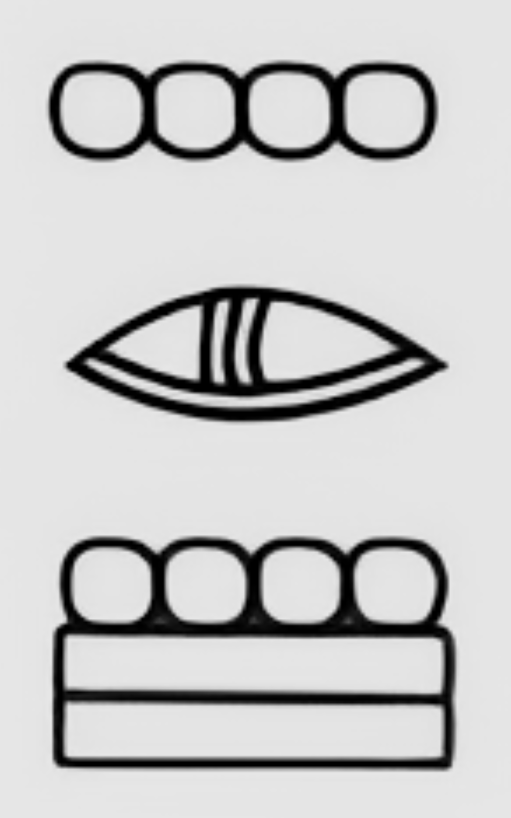
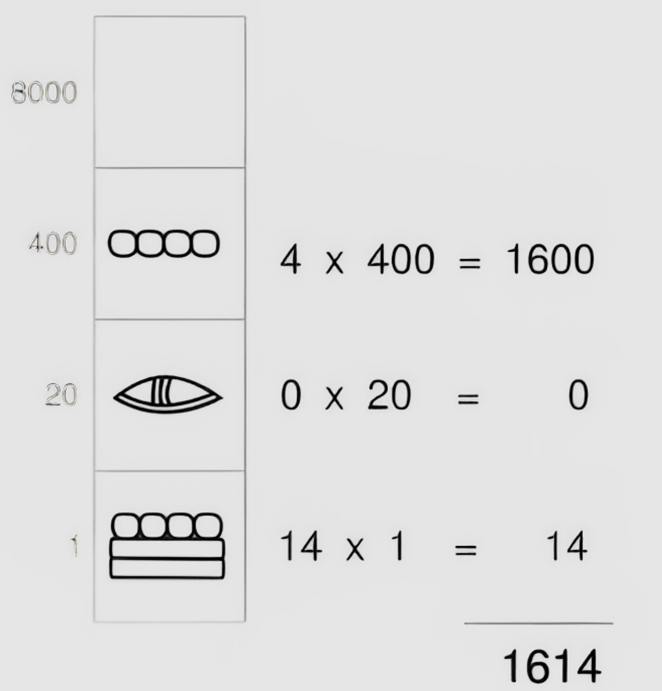
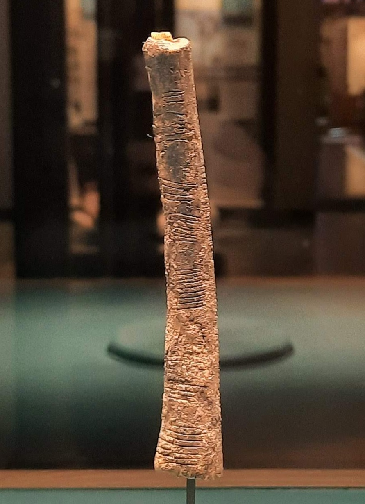

# Séance 1 — Définir, classer et retrouver

Un titre, une date, une photographie ou un prix peuvent constituer des données. Une application les conserve pour les afficher, les rechercher et les modifier.

On distingue d’abord **donnée et information**, puis on compare plusieurs manières de représenter une même quantité, jusqu’à l’écriture **binaire**. On classe ensuite un ensemble de **42 documents culturels** pour y rechercher des informations. Chaque réponse doit être justifiée par le document correspondant ; chaque comptage, par la liste des documents retenus.

## 1. Mettre les mots en commun

**Quand vous entendez « base de données », à quoi pensez-vous ?**

Proposez les mots qui vous viennent à l’esprit et un exemple concret pour chacun. Conservez cette liste pour la reprendre à la fin de la séance.

## 2. Distinguer donnée et information

Une **donnée** est une valeur ou une description représentée sous une forme que l’on peut conserver, transmettre ou traiter. Un nombre, un titre, une date ou une photographie peuvent constituer des données.

Une **information** est ce que l’on apprend en interprétant des données dans un **contexte**. Ce contexte précise à quoi les données se rapportent et comment les comprendre.

### Une même donnée, plusieurs significations

Observez cette valeur :

```text
12
```

Que représente-t-elle ? Un nombre d’objets, un prix, un âge ? La valeur seule ne permet pas de choisir. Comparons deux contextes possibles :

| Donnée | Contexte | Information obtenue |
|---|---|---|
| `12` | Nombre d’éléments dans la collection « À lire ». | La collection « À lire » contient 12 éléments. |
| `12` | Prix indiqué pour un livre, en euros. | Le prix indiqué pour ce livre est de 12 €. |

La valeur est identique, mais l’information obtenue change avec le contexte : l’objet concerné, le libellé et l’unité permettent de l’interpréter. Le contexte peut lui-même être enregistré sous forme de données, par exemple le nom de la collection ou la monnaie du prix.

### Justifier l’information obtenue

Savoir qu’une collection contient 12 éléments ne permet pas de connaître leurs titres. L’information formulée doit s’appuyer sur les données disponibles et leur contexte.

Reprenez un exemple proposé au début de la séance. Identifiez la donnée, précisez son contexte, puis formulez une information que vous pouvez en tirer. Indiquez aussi une conclusion que ces éléments ne permettent pas de soutenir. Faites relire votre exemple par une autre personne : dispose-t-elle du contexte nécessaire pour comprendre la donnée de la même façon ?

## 3. Les systèmes de numération

### Quantité et représentation

On compte les pommes de chaque ligne, puis on compare les deux écritures proposées.

| Pommes | Décimal | Binaire |
|---|---|---|
| 🍎 | 1 | 1 |
| 🍎🍎 | 2 | 10 |
| 🍎🍎🍎🍎🍎🍎🍎 🍎🍎🍎🍎🍎🍎🍎 | 14 | 1110 |

**La quantité reste la même ; son écriture dépend des conventions choisies.** Un **système de numération** définit les symboles et les règles qui permettent d’écrire et de lire les nombres. Ainsi, `10` en binaire représente la même quantité que `2` en décimal.

Les écritures `1`, `2` et `32` représentent des nombres. Quel rôle joue alors le symbole `0` ? On garde cette question pour la suite.

L’illustration suivante représente le nombre décimal **1614** en notation maya. On observe ses symboles avant d’en découvrir les règles de lecture.



<details>
<summary><strong>Comprendre la notation maya</strong></summary>

L’illustration ci-dessus représente le nombre **1614**. La notation maya présentée ici utilise trois signes :

- un point pour représenter `1` ;
- une barre pour représenter `5` ;
- un signe en forme de coquillage pour représenter `0`.

Les points et les barres se combinent pour écrire les valeurs de `1` à `19`. Les positions sont disposées verticalement. Dans la représentation en base 20 utilisée ici, le niveau inférieur vaut `20⁰ = 1`, le suivant `20¹ = 20`, puis `20² = 400`. Un zéro peut occuper tout niveau où la contribution est nulle. [Diane Davies, archéologue spécialiste des Mayas, « The Maya number system »](https://www.mayaarchaeologist.co.uk/the-main-differences-between-the-maya-number-system-and-ours/).

On retrouve alors la décomposition suivante :

```text
1614 = 4 × 400 + 0 × 20 + 14 × 1
```



Le zéro occupe ici le niveau des vingtaines. La quantité reste **1614**, même si les symboles et leur disposition changent.

</details>

### Décimal (base 10)

#### Les chiffres et leur position

Le système décimal utilise dix chiffres : `0123456789`.

```text
  0 -   9
 10 -  19
 20 -  29
 30 -  39
   ...
 90 -  99
100 - 199
200 - 299
   ...
900 - 999
```

Avec des **zéros non significatifs à gauche**, on peut écrire les mêmes nombres sur trois positions :

```text
000 - 009
010 - 019
020 - 029
030 - 039
   ...
090 - 099
100 - 199
200 - 299
   ...
900 - 999
```

Par exemple, `007` et `7` représentent la même quantité. Ces zéros à gauche préparent une écriture de longueur fixe.

#### Décomposer un nombre décimal

On décompose le nombre `847` :

```text
847 = 800 + 40 + 7
```

Chaque chiffre multiplie la valeur de sa position :

```text
847 = 8 × 100 + 4 × 10 + 7 × 1
```

Les valeurs des positions sont des puissances de dix :

```text
847 = 8 × 10² + 4 × 10¹ + 7 × 10⁰
```

| | Centaines | Dizaines | Unités |
|---|---|---|---|
| Rang | 2 | 1 | 0 |
| Valeur de la position | 10² = 100 | 10¹ = 10 | 10⁰ = 1 |
| Chiffre | 8 | 4 | 7 |
| Contribution au nombre | 800 | 40 | 7 |

La **base est 10**. Le **rang** commence à zéro à droite ; il devient l’exposant de la puissance. Chaque position vaut dix fois celle qui se trouve immédiatement à sa droite.

### Sexagésimal (base 60)

On observe cette autre succession d’écritures. Quelle convention pourrait expliquer le passage de `059` à `100`, puis de `5959` à `10000` ?

```text
000 - 009
010 - 019
020 - 029
030 - 039
040 - 049
050 - 059

100 - 109
110 - 119
120 - 129
130 - 139
140 - 149
150 - 159

200 - 209
210 - 219
220 - 229
230 - 239
240 - 249
250 - 259

...

5900 - 5909
5910 - 5919
5920 - 5929
5930 - 5939
5940 - 5949
5950 - 5959

10000 - 10009
10010 - 10019
10020 - 10029
...
10050 - 10059
10100 - 10159
...
15900 - 15959
```

<details>
<summary><strong>Révéler la convention</strong></summary>

On ajoute les séparateurs et les zéros à gauche : une écriture familière apparaît.

```text
00:00:00 → 00:00:09
00:00:10 → 00:00:19
00:00:20 → 00:00:59
00:01:00 → 00:01:59
00:02:00 → 00:02:59
00:59:00 → 00:59:59
01:00:00 → 01:00:59
```

Il s’agit de durées écrites en **heures, minutes et secondes**. Une minute regroupe 60 secondes ; une heure regroupe 60 minutes. Après `00:00:59`, la seconde suivante donne `00:01:00`. Après `00:59:59`, elle donne `01:00:00`.

Chaque groupe est écrit avec les chiffres décimaux, mais le passage d’un groupe au suivant se fait par **60**. Le principe sexagésimal apparaît aussi dans la subdivision des angles : un degré comprend 60 minutes d’arc, et une minute d’arc comprend 60 secondes d’arc.

</details>

### Vigésimal (base 20)

On énonce les dizaines jusqu’à cent : dix, vingt, trente, quarante, cinquante, soixante… Les noms suivants varient selon les usages francophones.

| Nombre | France | Belgique | Suisse romande | Québec |
|---|---|---|---|---|
| 70 | soixante-dix | septante | septante | soixante-dix |
| 80 | quatre-vingts | quatre-vingts | huitante ou quatre-vingts | quatre-vingts |
| 90 | quatre-vingt-dix | nonante | nonante | quatre-vingt-dix |

En Suisse romande, les formes « huitante » et « quatre-vingts » coexistent selon les régions. En France et en Belgique, l’usage courant est « quatre-vingts ». « Octante » désigne aussi 80, mais cette forme vieillie ne correspond à l’usage courant d’aucun des trois pays du tableau. [Académie française, « Septante, octante, nonante »](https://www.dictionnaire-academie.fr/article/QDL078).

On décompose les noms employés en France :

```text
soixante-dix     = 60 + 10
quatre-vingts    = 4 × 20
quatre-vingt-dix = 4 × 20 + 10
```

« Quatre-vingts » conserve la trace d’un comptage par groupes de vingt, appelé **vigésimal**. Le nom du nombre et son écriture chiffrée sont deux représentations : même lorsqu’on dit « quatre-vingts », l’écriture `80` reste décimale. [Académie française, « Septante, octante, nonante »](https://www.dictionnaire-academie.fr/article/QDL078).

### Binaire (base 2)

Le système binaire utilise seulement deux chiffres : `0` et `1`. Les données numériques d’un ordinateur sont représentées par des suites de **bits**. Un **bit** peut prendre deux valeurs, notées `0` et `1` ; dans l’écriture binaire d’un entier, chaque chiffre correspond à un bit.

Avec seulement ces deux chiffres, le rôle du zéro devient essentiel. On le retrouve d’abord dans un nombre décimal connu.

#### Le rôle du zéro

On décompose le nombre **décimal** `1023` :

```text
1023 = 1 × 1000 + 0 × 100 + 2 × 10 + 3 × 1
```

Le zéro indique qu’il n’y a **aucune centaine** à ce rang. Il conserve la position des autres chiffres. Le supprimer donnerait `123`, qui représente une autre quantité.

#### Notation positionnelle

Dans une notation positionnelle, la valeur d’un chiffre dépend de son rang. La base indique le multiplicateur entre deux positions voisines :

```text
Base 10 : 1023
          10³  10²  10¹  10⁰
          1    0    2    3
```

On applique le même principe à la base 2. Quelle quantité l’écriture `1101` représente-t-elle ?

```text
Base 2 : 1101
         2³   2²   2¹   2⁰
         1    1    0    1
```

Les positions valent `8`, `4`, `2` et `1`. On multiplie chaque chiffre par la valeur de sa position, puis on additionne les contributions. Un zéro conserve le rang, mais sa contribution à la somme est nulle.

Pour passer du décimal au binaire, on décompose la quantité en puissances de deux. On place `1` aux rangs utilisés et `0` aux autres rangs. La somme des contributions doit redonner le nombre décimal de départ.

### Unaire (comptage par marques)

Dans la numération **unaire**, parfois appelée « base 1 », chaque marque représente une unité. Le nombre cinq s’écrit par exemple `|||||`.

On compte les marques pour retrouver la quantité. Leur position ne multiplie pas leur valeur : ce système ne suit pas le principe positionnel des bases 10 et 2. Représenter un grand nombre demande donc beaucoup de marques.



### Exercices : changer de représentation

#### Exercice 1 : encoder

On représente le nombre décimal **17** en binaire en complétant la dernière ligne du tableau.

| 2⁴ | 2³ | 2² | 2¹ | 2⁰ |
|---|---|---|---|---|
| 16 | 8 | 4 | 2 | 1 |
| | | | | |

On vérifie ensuite que la somme des puissances de deux retenues redonne **17**, puis on explique le rôle des zéros placés dans l’écriture obtenue.

#### Exercice 2 : décoder

On cherche la valeur décimale du nombre binaire **101010**.

| 2⁵ | 2⁴ | 2³ | 2² | 2¹ | 2⁰ |
|---|---|---|---|---|---|
| 32 | 16 | 8 | 4 | 2 | 1 |
| 1 | 0 | 1 | 0 | 1 | 0 |

On écrit la somme des contributions, puis son résultat en décimal. Pour vérifier la réponse, on décompose ce résultat en puissances de deux : l’écriture obtenue doit être **101010**.

Dans les deux exercices, on précise ce qui change dans l’écriture et ce qui reste identique dans la quantité représentée. On conserve les deux conversions, leurs décompositions et leurs vérifications pour le bilan de la séance.

---

**Pause — 20 minutes**

---

## 4. Réorganiser librement

Comment organiser de nombreux documents pour y retrouver des informations ?

En groupe, ouvrez l’[interface web de classement](https://efp-dev.github.io/1-X75-LDB/exo/session_01.html) sur un ordinateur connecté à Internet. Vous disposez de **42 documents culturels** : couvertures, pochettes, affiches, documents de théâtre, billets, cartes postales et photographies de lieux. Ces objets peuvent être publiés et réunis en collections dans le [projet du module](projet.md).

Déplacez les images par glisser-déposer. Cliquez sur une image pour l’agrandir et lire ses inscriptions. **Les positions ne sont pas sauvegardées : recharger la page rétablit la disposition initiale.**

Votre première tâche est de **classer librement les documents**, avant de passer aux questions de recherche. Tous les groupes disposent du même ensemble, dans la même disposition initiale.

1. Créez un fichier `observations-classement.md` pour vos notes : règle de classement, difficultés et réponses aux recherches.
2. Choisissez une règle de classement et notez-la. Déplacez les documents pour former vos regroupements ; donnez un nom à chacun dans vos notes.
3. Si un document pourrait appartenir à plusieurs regroupements, décrivez la difficulté et justifiez votre choix.
4. Vérifiez que les 42 documents sont encore présents. Conservez une capture de l’ensemble pour comparer votre classement et le reprendre à la séance suivante.

**Conservez tous les documents, sans les modifier, les supprimer ni les dupliquer.**

## 5. Rechercher dans le classement

Répondez aux treize questions suivantes dans l’ordre, à partir de votre classement. Gardez les documents à leur place et ne rechargez pas la page pendant les recherches.

Pour les comptages, les livres comprennent les bandes dessinées, dont le manga. Les programmes de théâtre et le livret DVD restent distincts des livres. Les pochettes de disques comprennent les albums et les singles.

1. Quel document affiche un prix de 1,99 livre sterling ?
2. Quel document porte la référence CML-2456 ?
3. Combien de livres sont représentés, bandes dessinées comprises ?
4. Sur quelle façade peut-on lire « Societas MDCCXCII » ?
5. Quel document porte le logo d’Ethiopian Airlines ?
6. Quelle carte postale mentionne un moteur de 25 HP ?
7. Combien de pochettes de disques y a-t-il ?
8. Quel spectacle annonce une durée de 1 h 25 ?
9. Quel billet indique le placement « Balcon · B12 » ?
10. Quelle carte postale montre un Hôtel-Café de la Comédie ?
11. Combien d’affiches de cinéma y a-t-il ?
12. Quel document mentionne Ravi Shankar comme compositeur ?
13. Quelle pochette mentionne l’année 1972 ?

Pour chaque question, notez :

- la réponse, avec les titres ou les références permettant de retrouver les documents ;
- les documents qui justifient cette réponse ;
- le chemin suivi et les éventuels retours en arrière ;
- le temps nécessaire pour retrouver les documents et établir la réponse ;
- les hésitations ou les informations qui manquent.

Pour chaque comptage, dressez la liste des documents retenus. Cette liste doit permettre de vérifier le total et de repérer les oublis ou les doubles comptages.

Signalez les recherches inachevées pour les reprendre lors de la recherche dans le code source.

## 6. Comparer les classements

Choisissez une recherche facile et une recherche difficile dans votre classement. Pour chacune, expliquez ce qui vous a aidés ou gênés : regroupement directement repéré, documents répartis entre plusieurs groupes ou document rangé dans un groupe que vous n’aviez pas consulté.

### Faire utiliser le classement par un autre groupe

Invitez un autre groupe à reprendre les **questions 1 et 3** dans votre classement : retrouver le document affichant un prix de 1,99 livre sterling et compter les livres, bandes dessinées comprises. Laissez-le utiliser votre ordinateur sans expliquer oralement votre rangement. Les documents restent à leur place et la page reste ouverte.

Observez les regroupements visités, les parcours et les hésitations. Le groupe doit retrouver les documents qui justifient ses réponses et désigner ceux qu’il compte, même s’il connaît déjà les résultats.

Échangez ensuite les rôles et utilisez son classement. Comparez les regroupements parcourus pour chaque question. Si vos réponses diffèrent, comparez vos listes pour repérer un document oublié, compté deux fois ou rangé dans une autre catégorie.

### Mettre les observations en commun

Comparez vos observations avec celles des autres groupes :

- Quel critère organise chaque classement ?
- Quels documents se retrouvent ensemble ?
- Quelles recherches ce choix facilite-t-il ?
- Quel document a été difficile à placer, et pourquoi ?
- Une autre personne peut-elle retrouver l’information à partir des noms choisis ?

Appuyez vos comparaisons sur les recherches effectuées. Un classement par support peut faciliter la recherche d’un livre tout en séparant une œuvre de son programme de théâtre et de son billet. Le temps dépend aussi de votre familiarité avec les documents : les parcours et les hésitations aident à comprendre les différences observées.

## 7. Chercher autrement dans les mêmes documents

Les positions des images sont une manière d’organiser votre recherche. La page conserve aussi une description textuelle de chaque document. Ces descriptions permettent de chercher directement une référence, un nom ou une inscription.

<details>
<summary>Après la comparaison des classements : rechercher dans le code source</summary>

### Retrouver les descriptions des images

Depuis le plateau de classement, ouvrez le code source HTML de la page avec **Ctrl+U**. Dans ce nouvel onglet, ouvrez la recherche de texte du navigateur avec **Ctrl+F**.

Les images possèdent déjà des descriptions textuelles dans leur attribut `alt`. Ces textes alternatifs décrivent leur contenu, notamment pour les personnes qui utilisent un lecteur d’écran. Ils permettent aussi de retrouver les informations sans lire les inscriptions dans les images.

Pour reprendre la question 1, cherchez `1.99`. La description du document 04 permet de retrouver la pochette de Tanita Tikaram :

```html

```

L’attribut `src` indique le chemin du fichier image. L’attribut `alt` décrit ici le support, le titre, l’interprète et le prix inscrit. Le navigateur cherche dans ce texte ; les inscriptions de l’image ont déjà été transcrites. La notation compte : le texte utilise un point dans `1.99`, alors que la question utilise une virgule.

Lisez la description du document trouvé, puis revenez à l’image pour vérifier la réponse. Reprenez une autre question en cherchant une mention précise : référence, inscription, durée ou nom. Qu’est-ce qui facilite la recherche par rapport à votre classement visuel ?

### Distinguer les occurrences et les documents

Avec une recherche sans distinction entre majuscules et minuscules, `Megadeth` donne quatre résultats dans le code source pour deux documents : la pochette 06 et le billet 16. Le nom apparaît dans le chemin du fichier et dans le texte alternatif de chacun. Pour la question 9, la mention `B12` permet de retrouver le billet concerné.

Le nombre affiché par la recherche est donc un **nombre d’occurrences du texte recherché**. Un même document peut contenir plusieurs occurrences : comptez chaque document une seule fois.

Dans l’onglet du code source de `exo/session_01.html`, reprenez les trois comptages en cherchant successivement `Couverture de livre`, `Pochette de disque` et `Affiche de cinéma`. Chaque description concernée commence par l’une de ces expressions, présente une seule fois par document. Comparez les résultats à vos comptages visuels et retrouvez les documents qui les justifient.

Essayez aussi `livre` seul : ce texte apparaît dans `livret d’accompagnement du DVD`, au document 13. De même, `affiche` apparaît dans certains chemins d’images. Expliquez pourquoi une formulation plus précise change le résultat et répond mieux à la question posée.

### Comprendre le besoin avant de construire l’outil

**Pour répondre aux questions de cette activité, les données de la page et la recherche du navigateur suffisent.** Les descriptions sont déjà conservées dans un fichier et un outil permet déjà de les retrouver. Cette autre manière d’exploiter les documents reste disponible quel que soit leur classement visuel.

Le choix d’un outil dépend des opérations à réaliser : retrouver, compter, rapprocher ou modifier les données. Avant de construire une base ou d’installer un logiciel, identifiez vos besoins et ce que les données et les outils disponibles permettent déjà de faire.

Dans `observations-classement.md`, conservez une recherche effectuée dans le code source, sa réponse vérifiée et un exemple où le nombre d’occurrences diffère du nombre de documents.

</details>

## 8. Du classement aux bases de données et aux requêtes

### Les limites du classement et de la recherche textuelle

**Classer** consiste à regrouper ou à ordonner des éléments selon des critères. Parmi les 42 documents, un regroupement par prix facilite la recherche d’un montant. Il aide peu à répondre à une autre question : **quel document mentionne Ravi Shankar comme compositeur ?** Chercher seulement parmi les disques ferait manquer l’affiche de cinéma *Pather Panchali*, document 36.

Une recherche sur le nom permet de retrouver cette affiche sans déplacer les documents. Le même ensemble peut être recherché par prix, date, lieu ou personne. **L’enjeu est de répondre à des questions différentes sans refaire le classement à chaque demande.**

La recherche textuelle a toutefois ses limites : **Ctrl+F cherche une suite de caractères**, dont il faut interpréter le sens. Pour retrouver les documents qui affichent un montant à payer, essayez `prix` dans le code source, puis lisez les descriptions trouvées.

| Cas dans le corpus | Ce que la recherche permet de constater |
|---|---|
| L’affiche de *Quand la mer monte...*, document 09, mentionne le **prix Louis-Delluc 2004**. | Le mot est présent, mais désigne une récompense : c’est un **faux positif**, un résultat trouvé qui ne répond pas à la question. |
| La pochette de Tanita Tikaram, document 04, porte **Special Price £1.99**. | Le montant figure dans la description, mais pas le mot français `prix` : c’est un **faux négatif**, un document pertinent que la recherche manque. |

Le choix des termes et la qualité des descriptions déterminent les résultats. Si une inscription manque dans le texte, Ctrl+F ne peut pas la retrouver. De même, comme vous l’avez constaté avec `Megadeth`, compter les occurrences ne suffit pas à compter les documents.

### Distinguer base de données, SGBD et application

Ces recherches permettent de distinguer les données conservées des logiciels qui les exploitent.

| Notion | Rôle | Exemple dans le projet de collections |
|---|---|---|
| **Base de données** | Ensemble organisé de données conservées pour être retrouvées et exploitées. | Les données des éléments publiés, des utilisateurs et des collections. |
| **Système de gestion de base de données (SGBD)** | Logiciel qui permet de définir, conserver, rechercher et modifier les données. Il fournit aussi des mécanismes de contrôle des accès et de cohérence. | Il enregistre une nouvelle fiche, retrouve les éléments d’une collection et applique les droits d’accès à la base. |
| **Application** | Logiciel qui utilise les données pour proposer des pages et des fonctions à ses utilisateurs. | Elle affiche les collections et propose des formulaires de recherche ou de modification. |

Dans notre activité, le fichier HTML joue le rôle d’une petite base de données en **fichier plat** : les descriptions sont conservées directement dans ce fichier. **Ce fichier et Ctrl+F suffisent pour répondre aux treize questions**, en lisant les descriptions et en vérifiant les documents retenus.

Les besoins du projet iront plus loin : répéter des recherches combinant plusieurs critères, relier documents et collections, gérer des modifications simultanées ou attribuer des droits différents. Un SGBD fournit des mécanismes adaptés à ces opérations. Son choix se justifie par les besoins de gestion ; il ne dispense pas de décrire correctement les données ni de vérifier les réponses.

### Le modèle relationnel et l’indépendance des données

Le **modèle relationnel** organise les données en **relations**, représentées sous forme de tables. Une table décrit des enregistrements en lignes et leurs propriétés en colonnes. Des identifiants permettent de rapprocher les données de plusieurs tables.

Pour notre corpus, on pourrait distinguer le titre du document, sa nature, le montant inscrit et sa monnaie. Une récompense et un montant à payer seraient alors décrits par des propriétés distinctes. La précision de la recherche dépend donc aussi de la manière dont on structure les données.

En **1970, Edgar F. Codd** propose ce modèle pour permettre notamment d’exploiter les données sans connaître leur organisation interne dans la machine. Le principe d’**indépendance des données** vise à séparer les programmes des détails de leur stockage : une réorganisation physique doit pouvoir laisser les programmes qui utilisent les données inchangés. [Publication de Codd, 1970](https://research.ibm.com/publications/a-relational-model-of-data-for-large-shared-data-banks).

Les mêmes tables peuvent ainsi servir à plusieurs recherches, sans imposer un classement unique. En séance 2, vous reprendrez les 42 documents pour organiser leurs propriétés en tableaux, en conservant les informations nécessaires aux questions déjà résolues.

### Formuler une requête avec SQL ou une interface

Une **requête de recherche** est une demande adressée à un système pour obtenir des données selon des critères. « Retrouver les documents mentionnant Ravi Shankar comme compositeur » précise une personne et son rôle ; « compter les éléments d’une collection » demande un résultat calculé à partir des éléments retenus.

**SQL** est un langage utilisé pour interroger et gérer les bases de données relationnelles. Pour une recherche, on décrit le résultat attendu : les données à sélectionner, les conditions à respecter, le tri ou le comptage souhaité. Le SGBD détermine comment accéder aux données pour obtenir ce résultat. SQL permet aussi de définir leur structure, de les ajouter, de les modifier et de les supprimer. Sa syntaxe sera introduite à partir de la séance 3.

Une interface permet de formuler ces demandes sans écrire directement le langage utilisé par le système. Dans les contacts d’un téléphone, on saisit un nom ; dans une boutique, on combine une catégorie, une taille et une fourchette de prix. Ces filtres combinables sont souvent appelés **facettes**.

L’application traduit les choix de l’utilisateur en instructions exécutables. Elle peut notamment envoyer une requête SQL à un SGBD relationnel, puis présenter les résultats. D’autres systèmes utilisent d’autres langages : l’apparence d’un champ de recherche ne permet pas de déduire comment les données sont conservées ou interrogées.

### Vérifier et expliquer

Reprenez une de vos recherches dans `observations-classement.md`. Notez le critère recherché, le texte saisi, le numéro du document retenu et l’inscription qui justifie la réponse. Indiquez un résultat à écarter ou un document que la recherche manque, puis expliquez pourquoi. Une information absente reste signalée comme inconnue.

Reprenez enfin les mots proposés au début de séance. Expliquez la différence entre base de données, SGBD et application, puis citez un besoin couvert par le fichier HTML et Ctrl+F et un besoin du projet qui justifierait l’emploi d’un SGBD.
